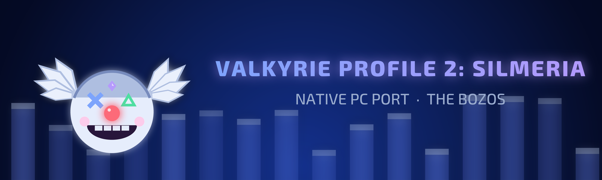
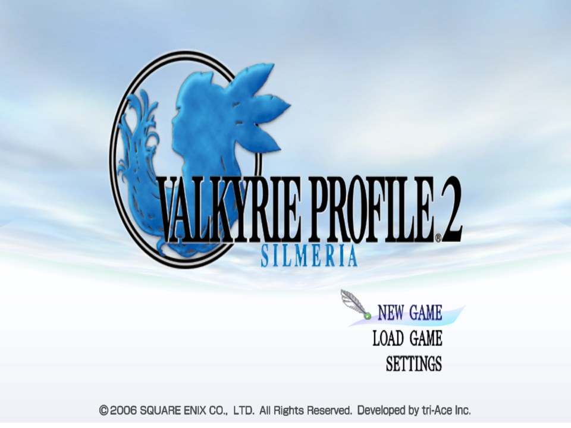
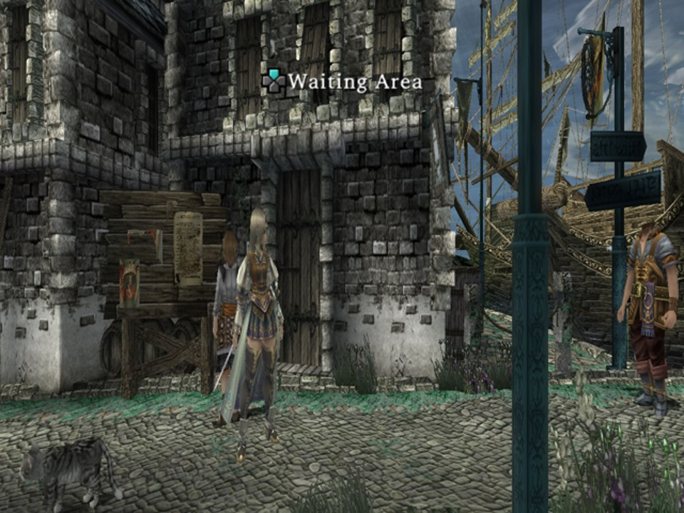
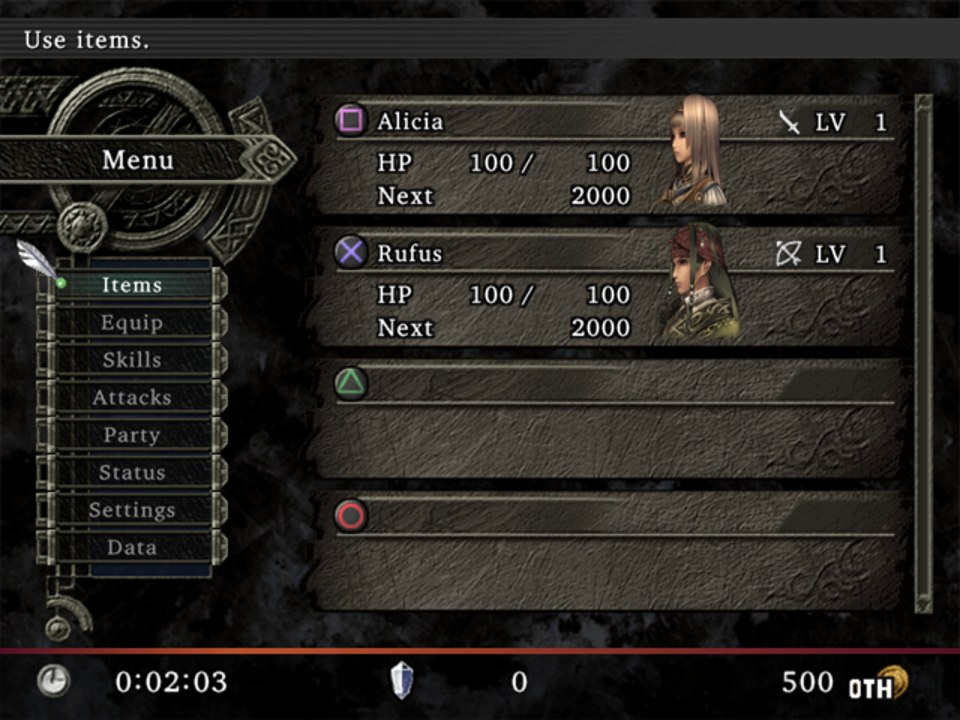
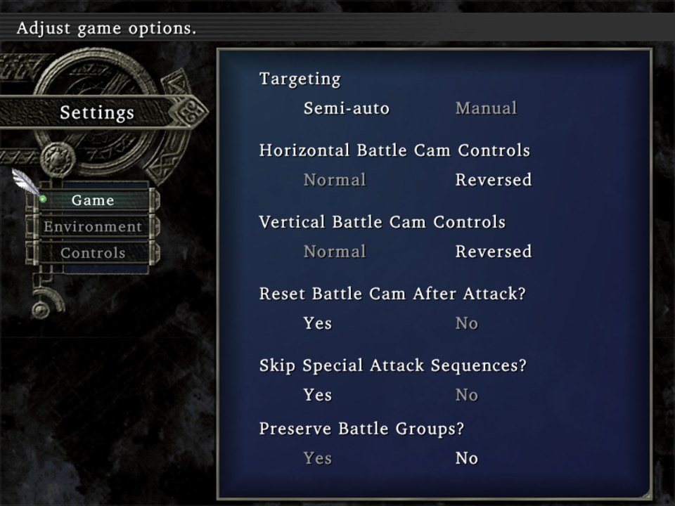
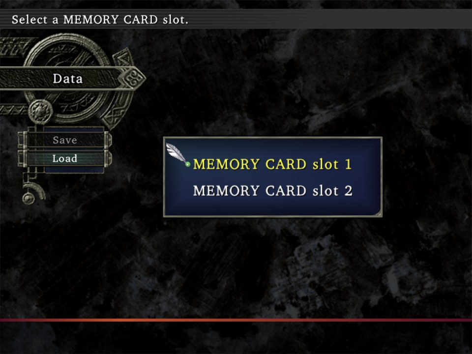

<div align="center">



# VP2S_Recomp

**A native Windows port of *Valkyrie Profile 2: Silmeria*, made by statically recompiling the game's PlayStation 2 code to C++.**<br>
The game's own MIPS R5900 code, rebuilt as a Windows program, drawing and playing sound natively: no GS, no VU1 and no SPU2 emulation on the default path.


-8a2be2)


</div>

> [!IMPORTANT]
> No game files are included: no ELF, overlay modules, IOP modules, decryption key, textures, meshes, or code
> generated from them. You need **your own copy** of the game. The port targets the **USA release, `SLUS-21452`**:
>
> | Release | File | SHA-1 |
> |---|---|---|
> | USA (target) | `SLUS_214.52` | `0534bfe1a7e6877b4430f2221ea7ce614fea4afd` |
> | PAL (former target, being dropped) | `SLES_546.45` | `541fa8d563b2834350fd0a635a4d3631574ad778` |
>
> The European build tree still exists (`build/`), but new work is done and checked on the USA disc only.

## Screenshots

Captured from `vp2s.exe` (USA disc), native renderer.

| | |
|:---:|:---:|
|  |  |
| Title screen (animated sky, matched against PCSX2) | The port town of Logun |
|  |  |
| Camp menu | Settings |
|  | |
| Load game (data menu) | |

## Goal: a PC port, not an emulator

The end state has **zero PS2 hardware emulation**. Only the game's own code runs: the recompiled EE code and its
recompiled IOP modules. Everything that code produces goes to native PC paths: a renderer with its own targets and
textures built from the game's data, an audio mixer on the PC's clock, and frames paced by the host with the real frame
time. No GS (VRAM, swizzling, CLUTs), no VU1 microcode, no VIF/GIF packets, no SPU2.

Emulated code is never the default: where a native path is still wrong, the native path gets fixed. The old GS path
stays only behind a comparison switch (`VP2S_GS=1`). The reference for how things should look and sound is the real
game on [PCSX2](https://pcsx2.net/), compared screen by screen (zone averages, and PCSX2 GS dumps to read the exact draw
order when a screen differs).

## Status

**Playable through the start of chapter 1** (the opening, the town of Logun, the battle tutorial and the first battles,
menus, saving). The menus and the town are being compared against PCSX2 one screen at a time.

| | |
|---|:---:|
| Main ELF and the overlay modules recompiled to C++ (the battle modules from the game's encrypted archives too) | ✅ |
| The game's ten IOP modules recompiled to C++ (none interpreted) | ✅ |
| **No GS by default** (`PS2X_GS_RENDERER=none`): GIF packets are neither drawn nor kept | ✅ |
| **No VU1 and no VIF1 processing**: the game's VIF1 chains end unprocessed, nothing runs on VU1 | ✅ |
| Models drawn natively from the game's model records (bones, lighting, materials, texture scrolling) | ✅ |
| Textures from the game's texture keys and an offline conversion of your disc | ✅ |
| Interface (menus, text, sprites, panels) drawn natively from the game's layout objects | ✅ |
| Post effects natively from the game's parameters: depth of field, the brightness pass, aerial perspective | ✅ |
| Movies decoded natively (FFmpeg), their sound streamed straight to the mixer | ✅ |
| **Native audio**: the game's sound library taken over at its API, mixed on the PC's clock (no SPU2) | ✅ |
| Frame loop on the PC's clock, real frame time | ✅ |
| Title screen, load / data menu, settings: matched against PCSX2 | ✅ |
| Logun: town and camp menu match; the pause screen loses the town (being fixed) | 🔧 |
| Battle HUD on the USA disc (one battle module, mod027, still to capture) | 🔧 |
| Rest of the game | ⏳ |
| Widescreen, higher internal resolution, frame rate options | ⏳ |

✅ works · 🔧 in progress · ⏳ not reached yet

[docs/RECOMPILER.md](docs/RECOMPILER.md) records every fix and how it was found; [docs/vp2_models.md](docs/vp2_models.md)
and [docs/vp2_dof.md](docs/vp2_dof.md) document the model format and the post effects as the port reads them;
[docs/AUDIT.md](docs/AUDIT.md) is the initial feasibility audit (disc layout, modules, compression and encryption).

## How it works

```
your disc ──► tools/extract.py ──► main ELF + overlay modules (decrypted, decompressed) + the game's asset files
                    │                          │
                    │   Ghidra (EE) + find_entry_points.py ──► function maps ──► ps2_recomp ──► C++
                    │                                                                         │
                    └─► offline conversions (textures, meshes, archives) ──┐                  │
                                                                           ▼                  ▼
                         PS2Recomp runtime (EE kernel HLE, DMAC, IOP) + native renderer / mixer ──► vp2s.exe
```

- Most of the game's code is loaded at run time as overlay modules, stored encrypted (SLE) and compressed (SLZ).
  `tools/extract.py` unpacks them; `tools/vp2_archives.py` opens the encrypted `p@Ck` archives, where the battle modules
  live. Modules met at run time that no archive holds are saved the first time the game loads them
  (`<build>/captured_modules/`, never committed) and recompiled by the next build.
- Ghidra (with the Emotion Engine extension) maps the functions; PS2Recomp turns each one into C++. Overlay calls are
  dispatched by slot, so a module's code runs only while it is resident.
- `port/` links the generated code with the runtime into `vp2s.exe` and hooks the game where it builds its draws: the
  model, interface and post-effect objects are read from the game's own memory and drawn natively.
- The game's textures and meshes are converted once, offline, from your disc (`tools/vp2_textures.py`,
  `tools/vp2_meshes.py`); the running game is matched to them by the keys it passes its own loaders.

The PS2Recomp fork lives in `external/PS2Recomp` (git submodule, [TheBozos/PS2Recomp](https://github.com/TheBozos/PS2Recomp),
branch `native/gs-backend`): the native renderer, the native mixer and most runtime fixes land there and are shared
with the team's other ports.

## Requirements

- Windows 10 or 11, Python 3.10 or later
- Visual Studio 2022 Build Tools ("Desktop development with C++": MSVC, CMake, Ninja), found with `vswhere` or `VP2S_VS_DIR`
- Ghidra (`GHIDRA_INSTALL_DIR`) and the Emotion Engine extension zip for that Ghidra version (`VP2S_GHIDRA_EE_ZIP`)
- Your own disc image of `SLUS-21452` (check the hash above)
- The 16-byte SLE key, in `VP2S_SLE_KEY` or `<build>/sle_key.txt` (32 hex digits). It is not distributed: the game
  computes it at boot; see `load_sle_key` in `tools/slz.py`.

## Build

```powershell
git clone --recurse-submodules https://github.com/TheBozos/VP2S_Recomp.git
cd VP2S_Recomp
$env:VP2S_BUILD = "build_usa"; $env:VP2S_ISO = "Valkyrie Profile 2 - Silmeria (USA).iso"
python tools/pipeline.py
```

`VP2S_BUILD` picks the build tree (`build` by default, the European one), `VP2S_ISO` the disc image (else the first
`.iso` in the project root). The pipeline runs `extract`, `wrap`, `ghidra`, `tool`, `sdk`, `entries`, `recomp`, `vu`,
`report`, `port`, `test`; each stage skips work whose outputs are up to date (`--only <stage>`, `--from <stage>`,
`--force`, `--inputs main,mod003`). The first full build takes a while: the recompiled code is several hundred MB of C++.

Then the offline conversions, once (they read the asset files `extract.py --assets` wrote):

```powershell
python tools/vp2_archives.py "<disc image>" --out build_usa/extract/assets
python tools/vp2_texture_keys.py --assets build_usa/extract/assets --index build_usa/vp2_texture_index.json
python tools/vp2_textures.py --assets build_usa/extract/assets --index build_usa/vp2_texture_index.json --out build_usa/vp2_textures
python tools/vp2_meshes.py --assets build_usa/extract/assets --out build_usa/vp2_meshes
```

The current mesh format is VPM3. Regenerate older VPM2 packs with the mesh command
above: editable vertex offsets are now converted offline, and the runtime no
longer interprets VIF commands to locate animated vertices.

The port build also runs `tools/vp2_music.py` to compile the streamed-music DSP and
convert its tables offline from the USA ELF. Its default decoder reads the game's
coefficient/history buffers directly; it does not process music VIF1 chains.
The IOP service and other hardware dependencies remain; see [music](docs/vp2_music.md).

Startup key derivation also uses the game's seed directly, with constants
converted offline by `tools/vp2_bootstrap.py`; its default path skips the VIF0
upload and VU0 execution. Other VU0/IOP work remains; see [VU0](docs/vp2_vu0.md).

[tools/README.md](tools/README.md) documents every stage and tool.

## Run

```powershell
build_usa\port\vp2s.exe build_usa\extract\iso\SLUS_214.52
```

or set `[game] elf` in `vp2s.ini` and start `vp2s.exe` alone. The disc image is found through `VP2S_ISO`, or by
searching upward from the ELF's folder (an image named `(USA)` first).

### Settings: `vp2s.ini`

Written next to `vp2s.exe`, with comments, the first time it starts. An environment variable with the same meaning wins
over the file, so test scripts and diagnostics keep working.

| Section | Key | Effect |
|---|---|---|
| `[game]` | `elf` | The `SLUS_214.52` to start when none is given on the command line |
| `[display]` | `window_size` | Window size at start, `WIDTHxHEIGHT` |
| | `show_fps` | The frame counter at the top right (F3 toggles it) |
| | `interpolate` | Frames in between the game's own (smoother motion, one frame later) |
| `[audio]` | `mute` | No sound |
| `[input]` | `start_analog` | The pad starts in analog mode (the party moves with the left stick in battles) |
| `[env]` | `NAME = value` | Any other runtime variable (testing, diagnostics) |

### Controls

A controller is used when one is connected; otherwise the keyboard (US key positions):

| PS2 button | Keyboard |
|---|---|
| D-pad | Arrow keys or W A S D |
| Cross / Circle / Square / Triangle | X or Space / C or Esc / Z or Numpad 0 / V or Numpad 1 |
| L1 / R1 / L2 / R2 | Q / E / Left Shift / Right Shift |
| Start / Select | Enter / Tab |

In the field, Start pauses and Select opens the camp menu.

| Key | What it does |
|---|---|
| F3 | Show or hide the counter at the top right: frames shown per second and EE speed |
| F9 | Screenshot of the game screen (`vp2s_shot_N.png`) |
| F1 | Runtime debugger (builds with `VP2S_DEBUG_UI`) |

<details>
<summary><b>Diagnostic and comparison options</b> (environment variables)</summary>

| Variable | Effect |
|---|---|
| `VP2S_ISO=<path>` | Disc image to read |
| `VP2S_GS=1` | The old GS path, to compare only |
| `PS2X_NATIVE_AUDIO=0` | The emulated SPU2 instead of the native mixer, to compare only |
| `PS2X_AUDIO_MUTE=1` | No sound (test runs) |
| `VP2S_DIAG=1` | Every 5 s: PC, resident modules, guest threads, IOP state, and a screenshot (`vp2s_diag_N.png`) |
| `VP2S_PROFILE=<seconds>` | Sampling profiler: where the busiest host threads spend their time |
| `VP2S_HANG_DUMP=<seconds>` | If the display freezes that long, write every host thread's stack to `vp2s_hang.txt` |
| `PS2X_PAD_SCRIPT=t:BUTTON[/ms],…` | Scripted button presses (seconds from start), for unattended runs |
| `PS2X_PAD_NO_HOST=1`, `PS2X_WINDOW_NO_FOCUS=1` | Test runs that never read your pad or take the focus |
| `PS2X_MPEG_SKIP=<n>` | End every movie after n pictures (tests; use 30) |
| `PS2X_CAPTURE_WINDOW_DIR=<dir>`, `PS2X_CAPTURE_INTERVAL=<n>` | Save the displayed frame every n frames |
| `VP2S_DRAW_ORDER_LOG=1` | Now and then, every model drawn with its batches, the post passes among them |
| `VP2S_POST_LOG=1`, `VP2S_UI_TREE_LOG=1`, `VP2S_UI_SPRITE_LOG=1` | The post effects' parameters, the interface's layer tree and its sprites |
| `VP2S_MODELS_SKIP=<i>,…` | Leave out the frame's i-th model (bisecting a picture) |

</details>

## Known issues

- **Pause screen in the field:** the town disappears behind the pause title (the game re-sends the town's prebuilt
  packets while paused, which the native path does not see yet); its blur and the PAUSE title are missing too.
- **Town look:** compared with PCSX2, the far distance is not blurred and the picture is a little brighter.
- **Battle HUD:** one battle module (mod027) is in no archive on the USA disc and has to be captured at the first battle.
- **European build:** kept for reference; its converted meshes need converting again after the USA-era format change.

## Repository layout

| Path | Contents |
|---|---|
| `tools/` | Pipeline, disc extractor, ELF wrapper, SLZ/SLE library, entry-point finder, archive / texture / mesh converters, `region_map.py` (EU to USA addresses) |
| `port/` | Native front end: entry point, settings, game overrides, native models / interface / textures, diagnostics; `port/app/` the window's icon |
| `ghidra_scripts/` | Headless Ghidra scripts |
| `scripts/` | One-off analysis and check scripts |
| `docs/` | Recompilation log, model and post-effect notes, feasibility audit; `docs/branding/` the logo and banner |
| `external/PS2Recomp` | PS2Recomp fork (submodule) |

Everything derived from the game (`build*/`, `extracted/`, `out/`, `work/`, `ghidra/`, disc images) is git-ignored.
Never commit or redistribute it.

**Logo.** VP2S's variant of The Bozos' logo: the team clown (console shapes: cross and triangle eyes, a red circle nose,
square teeth, on the PS2 BIOS blue with boot towers) in a winged Valkyrie helmet, drawn by `docs/branding/make_logo.py
vp2s` (the generator comes from TMB_Recomp). No game art.

## Credits

- [The Bozos](https://github.com/TheBozos) (boubou666, Arzaroth): this port, and the team's other PS2 recompilations it shares its fork with.
- [PS2Recomp](https://github.com/ran-j/PS2Recomp) by ran-j and contributors (GPL), the recompiler and runtime this port is built on.
- The Drakengard recompilation and the team's other ports (TMB, JC2, TTA), developed alongside this port on the same PS2Recomp fork; many runtime fixes are shared.
- [PCSX2](https://pcsx2.net/), the reference every screen is compared against.
- *Valkyrie Profile 2: Silmeria* © tri-Ace / Square Enix. This is an unofficial fan project, not affiliated with or endorsed by them.
