<div align="center">

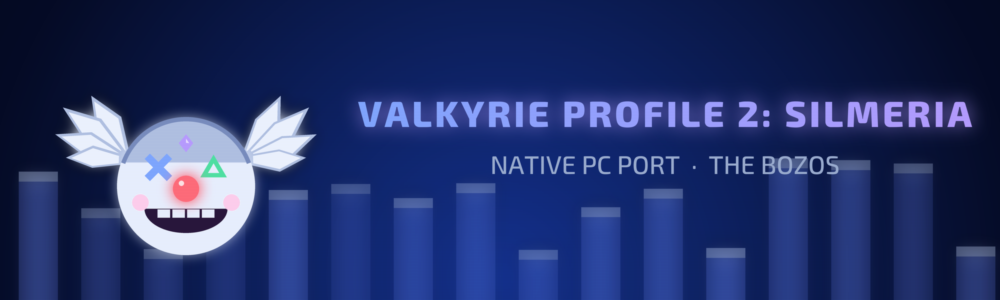

# VP2S_Recomp

**A native Windows port of *Valkyrie Profile 2: Silmeria*, made by statically recompiling the game's PlayStation 2 code to C++.**<br>
The game's own MIPS R5900 and IOP code, rebuilt as a Windows program, drawing natively: no GS, no VU0 or VU1 microcode, and no SPU2 emulation.


-8a2be2)


</div>

> [!IMPORTANT]
> No game files are included: no ELF, overlay modules, IOP modules, decryption key, textures, meshes, or code
> generated from them. You need **your own copy** of the game. The port targets the **USA release, `SLUS-21452`**:
>
> | Release | File | SHA-1 |
> |---|---|---|
> | USA (target) | `SLUS_214.52` | `0534bfe1a7e6877b4430f2221ea7ce614fea4afd` |
> | PAL (former target, dropped) | `SLES_546.45` | `541fa8d563b2834350fd0a635a4d3631574ad778` |

## Screenshots

Captured from the BozoEngine runner (`vp2s-bozo-headless`, USA disc) at the game's own 576 × 416 frame, shown at 4:3.

| | |
|:---:|:---:|
| 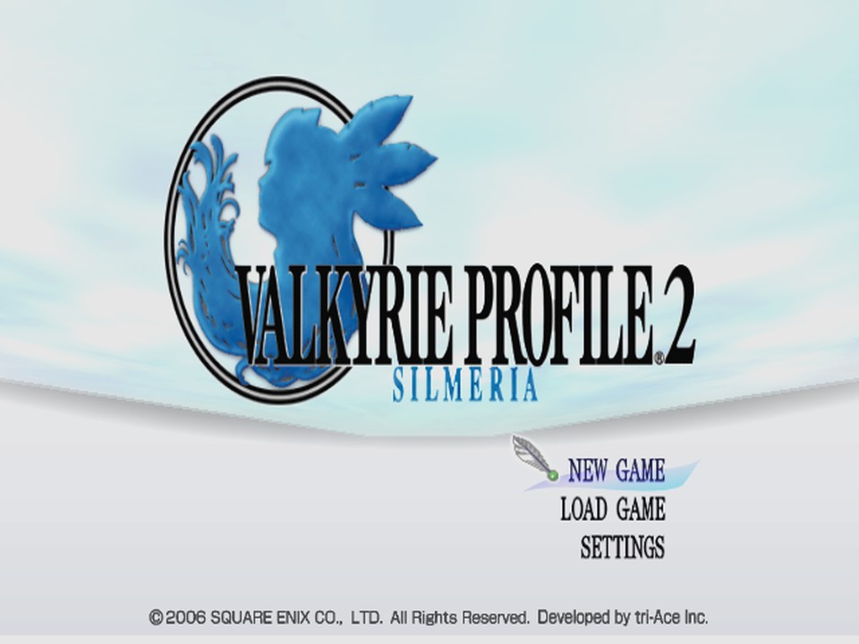 | 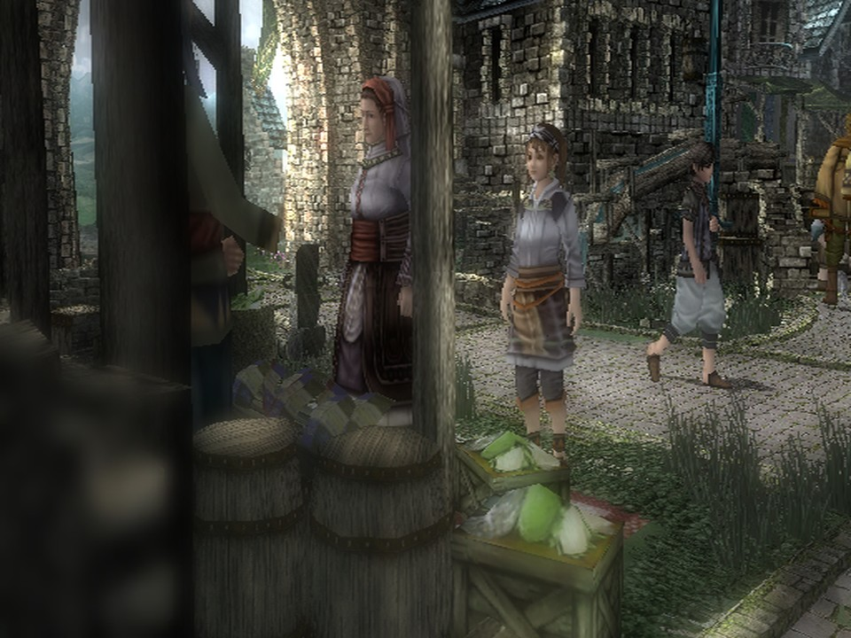 |
| Title screen | The port town of Logun |
| 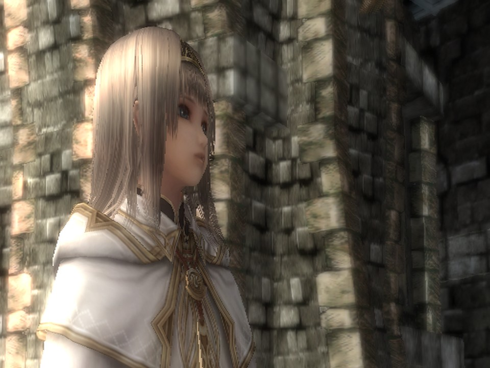 | 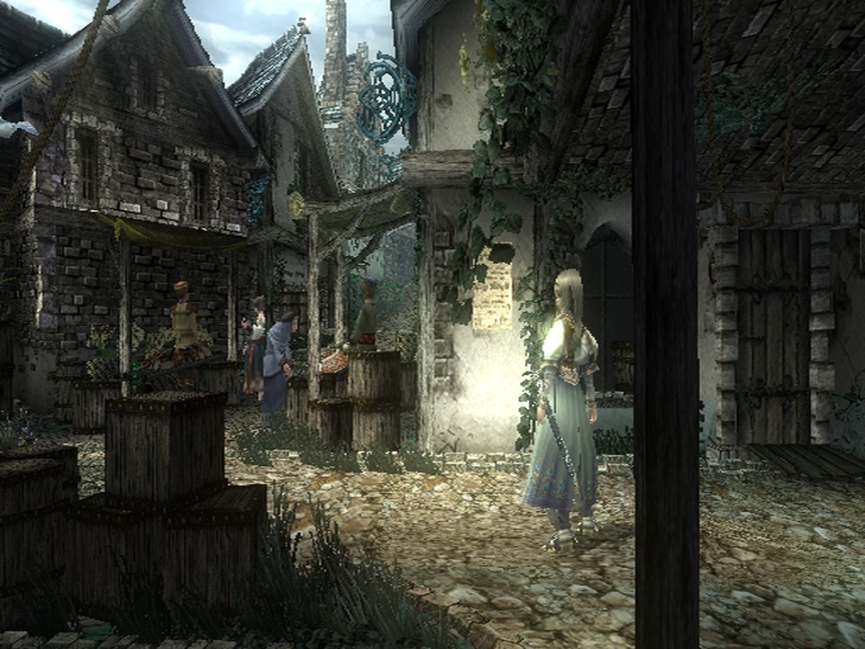 |
| An event scene: Alicia | The town of Solde |
| 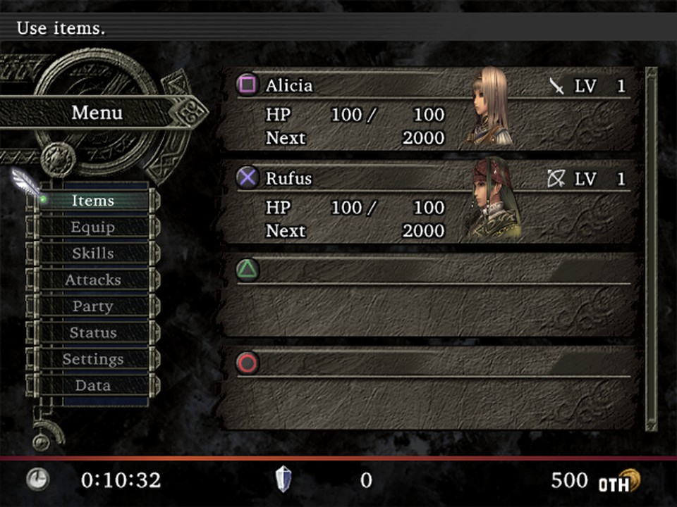 | 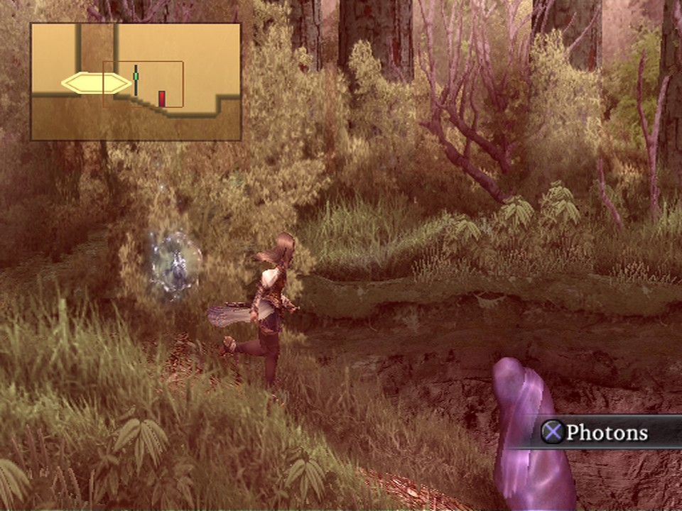 |
| Camp menu | The Lost Forest: photons and the minimap |

### Battle

| | |
|:---:|:---:|
| 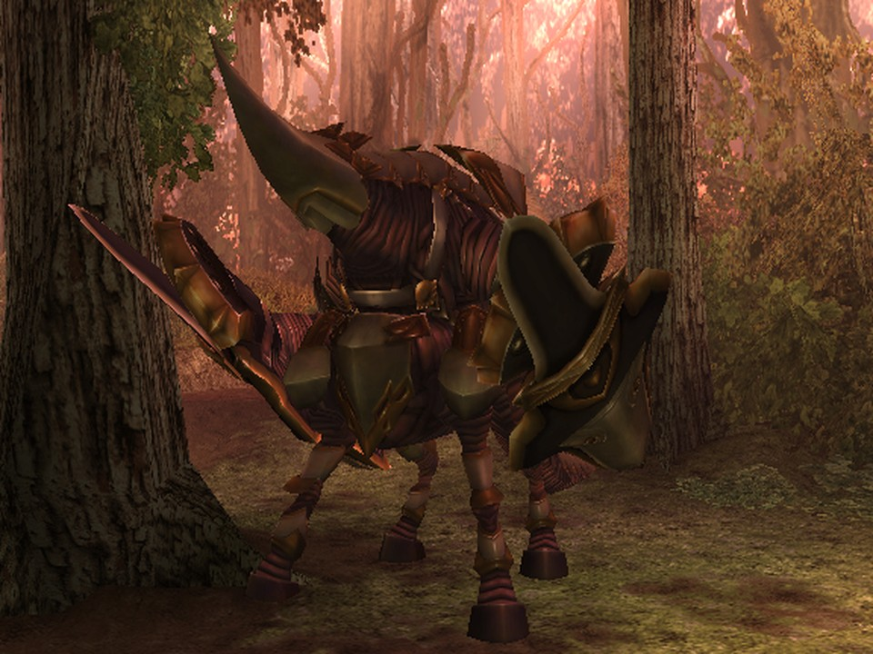 | 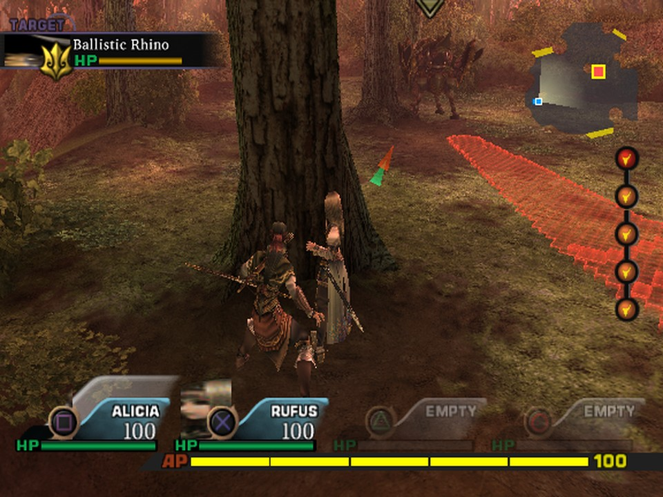 |
| The Ballistic Rhino appears | Movement mode: party HUD, target and minimap |
| 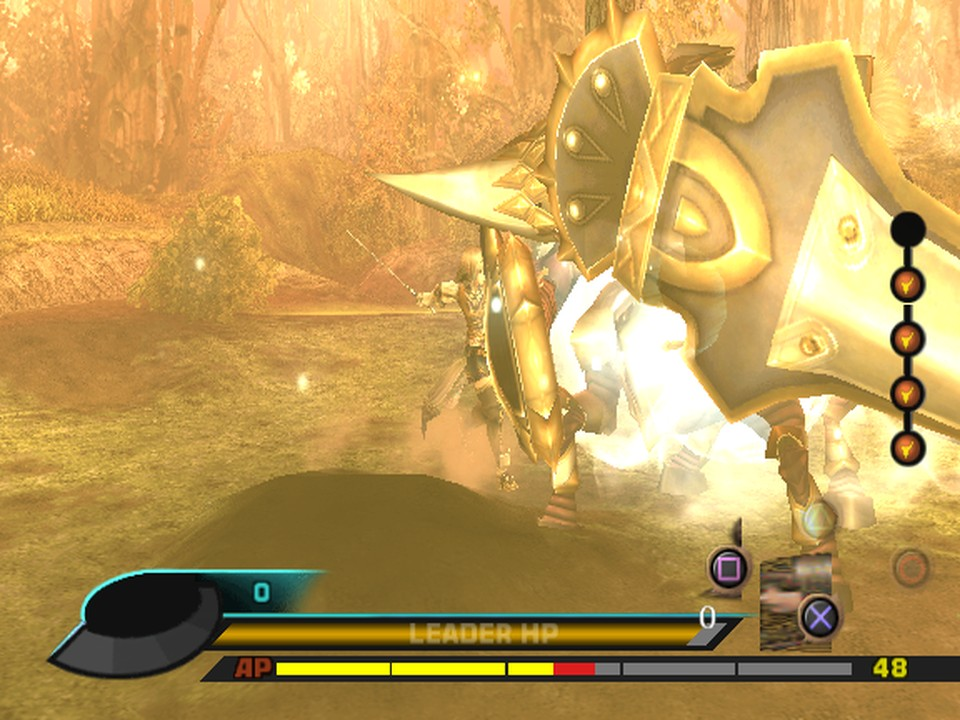 | 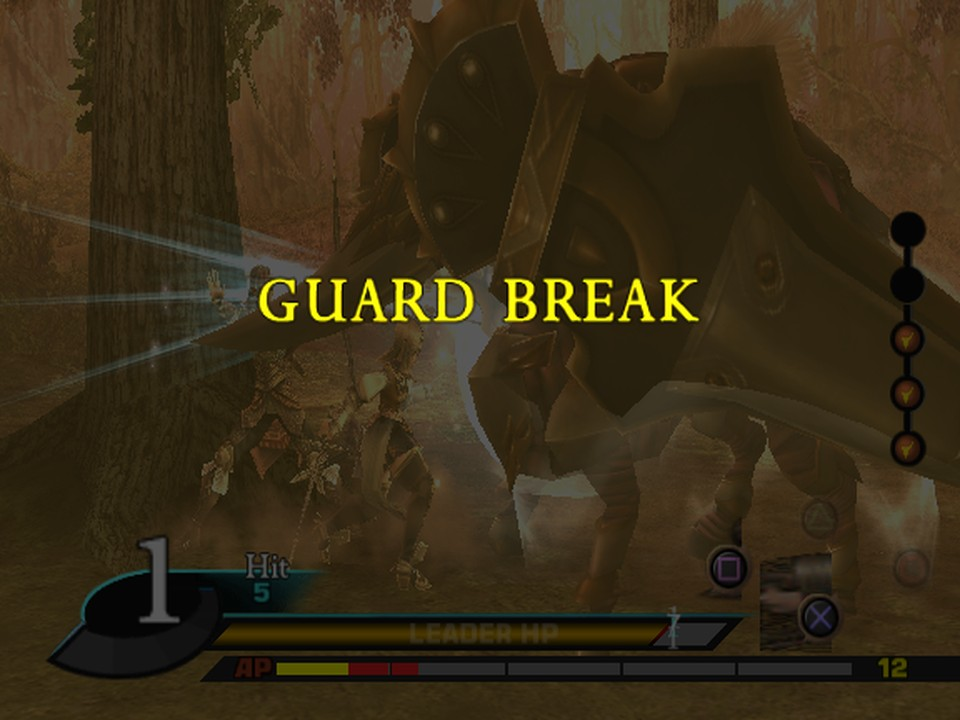 |
| An attack turn's hit effects | GUARD BREAK |

## Goal: a PC port, not an emulator

The end state has **zero PS2 hardware emulation**. Only the game's own code runs: the recompiled EE code and its
recompiled IOP modules. Everything that code produces goes to native PC paths: a renderer with its own targets and
textures built from the game's data, an audio mixer on the PC's clock, and frames paced by the host with the real frame
time. No GS (VRAM, swizzling, CLUTs), no VU microcode, no VIF/GIF packets, no SPU2.

Emulation is never the fix: where a native path is wrong, the native path gets fixed. Every VU0 instruction the game
runs is ported as the algorithm it computes (with the VU's own rounding), and an instruction that is not ported yet
stops the run with its address instead of being emulated. The reference for how things should look and sound is the
real game on [PCSX2](https://pcsx2.net/), compared screen by screen (and PCSX2 GS dumps to read the exact draw order
when a screen differs).

## Status

The port has two runners. Work now goes into the second.

| Runner | Base | State |
|---|---|---|
| `vp2s.exe` | [PS2Recomp](https://github.com/TheBozos/PS2Recomp) fork | Playable through the start of chapter 1. Frozen since early November 2026. |
| `vp2s-bozo-headless` | [BozoEngine](https://github.com/TheBozos/BozoEngine) | Fully native, with no emulation fallback at all. It runs hidden from pad scripts and saved states, saving frames as PNG files; there is no game window or sound output yet. |

**BozoEngine runner:**

| | |
|---|:---:|
| Main ELF and 23 overlay modules recompiled, including the battle modules (from the game's encrypted archives, or captured at load) | ✅ |
| The game's IOP modules (DBC manager, controller, sound device library, CSM, CSD, CSI) recompiled from their `.irx` files | ✅ |
| No GS, VIF or VU1: models, interface, particles, shadows and post effects drawn natively from the game's records | ✅ |
| VU0 code replaced by native algorithms; an unported site stops the run with its address | ✅ |
| Movies decoded natively; music decoded natively from the game's own buffers | ✅ |
| Boot, opening movies, title screen | ✅ |
| Logun's harbour, the town of Solde: streets, houses, camp menu | ✅ |
| Leaving town, the world map, the Lost Forest (haze, particles, minimap) | ✅ |
| First battle (Ballistic Rhino, started with the `--battle` debug launcher): HUD, attack turns, effects, 16 000+ frames with no unported site | 🔧 |
| Game window, live input and sound output | ⏳ |
| Rest of the game | ⏳ |

✅ works · 🔧 in progress · ⏳ not reached yet

These documents record the work:
- [docs/BOZO_MIGRATION.md](docs/BOZO_MIGRATION.md) is the BozoEngine port's log, newest first: every native algorithm with its evidence.
- [docs/RECOMPILER.md](docs/RECOMPILER.md) is the PS2Recomp-era log.
- [docs/vp2_models.md](docs/vp2_models.md) and [docs/vp2_dof.md](docs/vp2_dof.md) document the model format and the post effects.
- [docs/AUDIT.md](docs/AUDIT.md) is the initial feasibility audit: disc layout, modules, compression and encryption.

## How it works

```
your disc ──► tools/extract.py ──► main ELF + overlay modules (decrypted, decompressed) + IOP modules + asset files
                    │                          │
                    │                          ├─► BozoEngine's bozo-recomp (EE) and native_irx (IOP) ──► C++ ──┐
                    │                          │                                                               │
                    │                          └─► Ghidra + ps2_recomp (PS2Recomp, the older runner) ──► C++    │
                    │                                                                                          ▼
                    └─► offline conversions (textures, meshes, glyphs, music tables) ──► BozoEngine runtime + bozo/ ──► vp2s-bozo-headless
```

- Most of the game's code is loaded at run time as overlay modules, stored encrypted (SLE) and compressed (SLZ).
  `tools/extract.py` unpacks them; `tools/vp2_archives.py` opens the encrypted `p@Ck` archives, where the battle modules
  live. Modules that no archive holds are saved the first time the game loads them (`<build>/captured_modules/`, never
  committed) and recompiled by the next build.
- `tools/vp2_bozo.py` prepares the images, has BozoEngine recompile each module to C++, and builds the runner. Each
  remaining COP2 (VU0) instruction is compiled as a guarded native site. `bozo/` holds the port's native side:
  - the VU0 algorithms (`native_math.cpp`, `native_random.cpp`, ...);
  - the kernel bindings;
  - the readers that turn the game's model, interface, particle and effect records into native draws.
- The game's textures and meshes are converted once, offline, from your disc (`tools/vp2_textures.py`,
  `tools/vp2_meshes.py`, then `tools/vp2_bozo_meshes.py`). The running game is matched to them by the keys it passes its
  own loaders.

The engine lives in `external/BozoEngine` (git submodule, [TheBozos/BozoEngine](https://github.com/TheBozos/BozoEngine)),
shared with the team's other ports. The older runner's PS2Recomp fork is still in `external/PS2Recomp`.

## Requirements

- Windows 10 or 11, Python 3.10 or later
- Your own disc image of `SLUS-21452` (check the hash above)
- The 16-byte SLE key, in `VP2S_SLE_KEY` or `<build>/sle_key.txt` (32 hex digits). It is not distributed: the game
  computes it at boot; see `load_sle_key` in `tools/slz.py`.
- For the BozoEngine runner:
  - MSYS2 UCRT64 (`C:\msys64\ucrt64`: g++, CMake, Ninja);
  - an FFmpeg development tree (`BOZO_FFMPEG_ROOT` or `--ffmpeg`).
- For the extraction pipeline and the older runner:
  - Visual Studio 2022 Build Tools ("Desktop development with C++": MSVC, CMake, Ninja);
  - Ghidra (`GHIDRA_INSTALL_DIR`) with the Emotion Engine extension zip (`VP2S_GHIDRA_EE_ZIP`).

## Build

```powershell
git clone --recurse-submodules https://github.com/TheBozos/VP2S_Recomp.git
cd VP2S_Recomp
$env:VP2S_BUILD = "build_usa"; $env:VP2S_ISO = "Valkyrie Profile 2 - Silmeria (USA).iso"
python tools/pipeline.py
```

The pipeline extracts the disc and builds the older runner:
- `VP2S_BUILD` picks the build tree;
- `VP2S_ISO` picks the disc image (else the first `.iso` in the project root);
- the stages are `extract`, `wrap`, `ghidra`, `tool`, `sdk`, `entries`, `recomp`, `vu`, `report`, `port`, `test`;
- each stage skips work whose outputs are up to date (`--only <stage>`, `--from <stage>`, `--force`).

Then run the offline conversions, once (they read the asset files `extract.py --assets` wrote):

```powershell
python tools/vp2_archives.py "<disc image>" --out build_usa/extract/assets
python tools/vp2_texture_keys.py --assets build_usa/extract/assets --index build_usa/vp2_texture_index.json
python tools/vp2_textures.py --assets build_usa/extract/assets --index build_usa/vp2_texture_index.json --out build_usa/vp2_textures
python tools/vp2_meshes.py --assets build_usa/extract/assets --out build_usa/vp2_meshes
```

Then the BozoEngine runner:

```powershell
python tools/vp2_bozo.py --stage build --jobs 4
```

This builds the engine's tools and generates the C++ for main and the 23 overlay modules (`--inputs`). It also
converts particle materials, meshes, glyphs and music tables into `build_usa/bozo`, then builds
`build_usa/bozo_port/vp2s-bozo-headless.exe` and runs its 95 unit checks (`ctest`). `--stage generate` stops after the
generated code. After changing only `bozo/` sources, `cmake --build build_usa/bozo_port` is enough.

[tools/README.md](tools/README.md) documents every stage and tool.

## Run

### BozoEngine runner

```powershell
build_usa\bozo_port\vp2s-bozo-headless.exe --iso "Valkyrie Profile 2 - Silmeria (USA).iso" --frames 40000 `
    --pad-script tools\pad_scripts\bozo_logun_armory.txt --capture shots\c.png
```

The runner has no window or live input yet. It plays the game for `--frames` frames from a pad script and saves the
frames it draws. A site the port has not made native yet ends the run with its address, the function it is in, and
the CPU registers.

| Option | Effect |
|---|---|
| `--iso <file>` | Your USA disc image (required) |
| `--frames <n>` | Frames to run |
| `--pad-script <file>` | Button presses as `frame:BUTTON/frames,…`; `tools/pad_scripts/` has the boot-to-Logun-to-forest route and a battle |
| `--capture <file.png>` | Save frames as `<file>_<frame>.png`; `VP2S_BOZO_CAPTURE_FROM` and `VP2S_BOZO_CAPTURE_EVERY` choose which ones |
| `--save-state <file> --save-state-at <frame>`, `--load-state <file>` | Save the whole machine at a frame, and start from it later |
| `--card-dir <dir>` | Memory cards in a folder. Without it, the cards are fresh, formatted and kept in memory, so your saves are never opened |
| `--warp <map>[,x,y,z[,facing[,entry]]]` | Debug: the next event-script step changes to that map |
| `--battle <id>[,stage[,flags]]` | Debug: the next event-script step starts that battle (event op 0x38) |

`VP2S_BOZO_SEED` fixes the game's random seed, so runs repeat frame for frame. `VP2S_BOZO_BOUNDARY_RAM=<file>` saves
EE memory when a run stops at an unported site.

### Older runner (`vp2s.exe`)

```powershell
build_usa\port\vp2s.exe build_usa\extract\iso\SLUS_214.52
```

or set `[game] elf` in `vp2s.ini` and start `vp2s.exe` alone. The disc image is found through `VP2S_ISO`, or by
searching upward from the ELF's folder (an image named `(USA)` first).

#### Settings: `vp2s.ini`

Written next to `vp2s.exe`, with comments, the first time it starts. An environment variable with the same meaning wins
over the file, so test scripts and diagnostics keep working.

| Section | Key | Effect |
|---|---|---|
| `[game]` | `elf` | The `SLUS_214.52` to start when none is given on the command line |
| `[display]` | `window_size` | Window size at start, `WIDTHxHEIGHT` |
| | `show_fps` | The frame counter at the top right (F3 toggles it) |
| | `interpolate` | Frames in between the game's own (smoother motion, one frame later) |
| `[audio]` | `mute` | No sound |
| `[input]` | `start_analog` | The pad starts in analog mode (the party moves with the left stick in battles) |
| `[env]` | `NAME = value` | Any other runtime variable (testing, diagnostics) |

#### Controls

A controller is used when one is connected; otherwise the keyboard (US key positions):

| PS2 button | Keyboard |
|---|---|
| D-pad | Arrow keys or W A S D |
| Cross / Circle / Square / Triangle | X or Space / C or Esc / Z or Numpad 0 / V or Numpad 1 |
| L1 / R1 / L2 / R2 | Q / E / Left Shift / Right Shift |
| Start / Select | Enter / Tab |

In the field, Start pauses and Select opens the camp menu.

| Key | What it does |
|---|---|
| F3 | Show or hide the counter at the top right: frames shown per second and EE speed |
| F9 | Screenshot of the game screen (`vp2s_shot_N.png`) |
| F1 | Runtime debugger (builds with `VP2S_DEBUG_UI`) |

<details>
<summary><b>Diagnostic and comparison options</b> (environment variables)</summary>

| Variable | Effect |
|---|---|
| `VP2S_ISO=<path>` | Disc image to read |
| `VP2S_GS=1` | The old GS path, to compare only |
| `PS2X_NATIVE_AUDIO=0` | The emulated SPU2 instead of the native mixer, to compare only |
| `PS2X_AUDIO_MUTE=1` | No sound (test runs) |
| `VP2S_DIAG=1` | Every 5 s: PC, resident modules, guest threads, IOP state, and a screenshot (`vp2s_diag_N.png`) |
| `VP2S_PROFILE=<seconds>` | Sampling profiler: where the busiest host threads spend their time |
| `VP2S_HANG_DUMP=<seconds>` | If the display freezes that long, write every host thread's stack to `vp2s_hang.txt` |
| `PS2X_PAD_SCRIPT=t:BUTTON[/ms],…` | Scripted button presses (seconds from start), for unattended runs |
| `PS2X_PAD_NO_HOST=1`, `PS2X_WINDOW_NO_FOCUS=1` | Test runs that never read your pad or take the focus |
| `PS2X_MPEG_SKIP=<n>` | End every movie after n pictures (tests; use 30) |
| `PS2X_CAPTURE_WINDOW_DIR=<dir>`, `PS2X_CAPTURE_INTERVAL=<n>` | Save the displayed frame every n frames |
| `VP2S_DRAW_ORDER_LOG=1` | Now and then, every model drawn with its batches, the post passes among them |
| `VP2S_POST_LOG=1`, `VP2S_UI_TREE_LOG=1`, `VP2S_UI_SPRITE_LOG=1` | The post effects' parameters, the interface's layer tree and its sprites |
| `VP2S_MODELS_SKIP=<i>,…` | Leave out the frame's i-th model (bisecting a picture) |

</details>

## Known issues

- **BozoEngine runner:** no game window, live input or sound output yet. Battles are reached only with the `--battle`
  debug launcher, not by playing into one. A scene the route has not visited may stop at a site that is not native yet.
- **Field pause (BozoEngine runner):** the PAUSE screen's background is black; the game shows the frozen scene behind it.
- **Older runner:** frozen in early November 2026. Its field pause screen loses the town, and Logun's far distance
  is less blurred and a little brighter than on PCSX2.

## Repository layout

| Path | Contents |
|---|---|
| `tools/` | Pipelines (`pipeline.py`, `vp2_bozo.py`), disc extractor, SLZ/SLE library, archive / texture / mesh / glyph converters, pad scripts |
| `bozo/` | The BozoEngine runner: entry point, kernel bindings, native VU0 algorithms, native models / interface / particles / effects |
| `tests/` | The runner's unit checks (`vp2s-bozo-*-check`): each native algorithm against a VU0 reference or recorded game values |
| `port/` | The older runner's front end (PS2Recomp): entry point, settings, game overrides, native models / interface / textures; `port/app/` the window's icon |
| `ghidra_scripts/` | Headless Ghidra scripts |
| `scripts/` | One-off analysis and check scripts |
| `docs/` | BozoEngine port log, recompilation log, model and post-effect notes, feasibility audit; `docs/branding/` the logo and banner |
| `external/BozoEngine` | BozoEngine (submodule): recompiler, IOP recompiler, runtime, renderer |
| `external/PS2Recomp` | PS2Recomp fork (submodule), for the older runner |

Everything derived from the game (`build*/`, `extracted/`, `out/`, `work/`, `ghidra/`, disc images) is git-ignored.
Never commit or redistribute it.

**Logo.** VP2S's variant of The Bozos' logo: the team clown (console shapes: cross and triangle eyes, a red circle nose,
square teeth, on the PS2 BIOS blue with boot towers) in a winged Valkyrie helmet, drawn by `docs/branding/make_logo.py
vp2s` (the generator comes from TMB_Recomp). No game art.

## Credits

- [The Bozos](https://github.com/TheBozos) (boubou666, Arzaroth): this port, and the team's other PS2 recompilations it shares its fork with.
- [BozoEngine](https://github.com/TheBozos/BozoEngine), The Bozos' recompiler and native runtime, which the port now runs on.
- [PS2Recomp](https://github.com/ran-j/PS2Recomp) by ran-j and contributors (GPL), the recompiler and runtime the port was first built on.
- The Drakengard recompilation and the team's other ports (TMB, JC2, TTA), developed alongside this port on the same engines; many runtime fixes are shared.
- [PCSX2](https://pcsx2.net/), the reference every screen is compared against.
- *Valkyrie Profile 2: Silmeria* © tri-Ace / Square Enix. This is an unofficial fan project, not affiliated with or endorsed by them.
